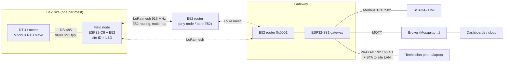
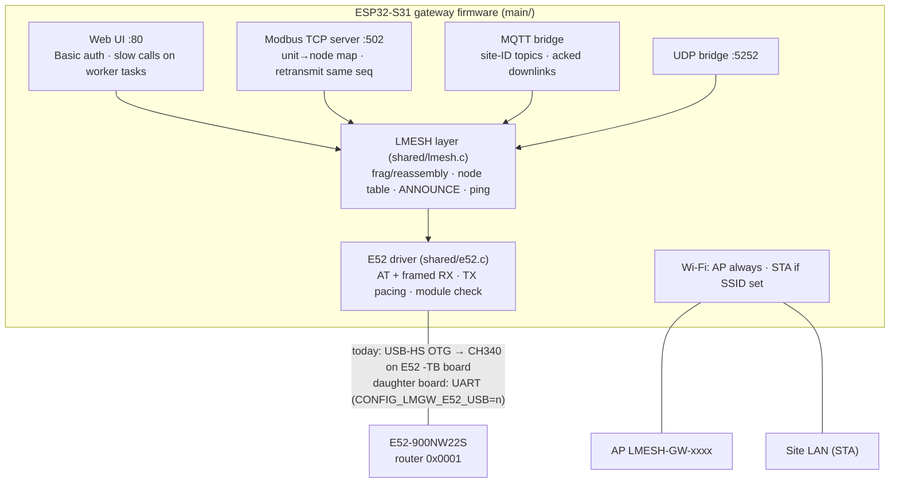

# LMESH design notes

LoRa mesh SCADA network: field RTUs on RS-485 → masthead nodes → Ebyte E52 LoRa mesh → border gateway → Modbus TCP and MQTT.

This document collects how the system is built and what bench bring-up taught us (November 2026). Code lives in this repo:
- `main/`: gateway firmware
- `node/`: field node firmware
- `shared/`: E52 driver and the LMESH layer, used by both
- `tools/`: bench tools

Drawings:
- [node-wiring.svg](node-wiring.svg): field node wiring as built and tested
- [e52-radio-schematic.svg](e52-radio-schematic.svg): minimum E52 radio circuit for the gateway and node daughter boards

---

## 1. System



The radios form the mesh on their own. LMESH is our thin layer on top: ports, fragmentation, request/response matching, retries and acknowledgements. It turns that mesh into something that behaves like UDP between the gateway and nodes.

## 2. Gateway



| Function | Detail |
|---|---|
| Modbus TCP :502 | Unit ID → node via the Unit Map (unmapped unit N goes to mesh node N). One transaction per node at a time. Retransmits the same seq after ~3× a normal round trip (1.2 s base at rate 1). Gives up at `mb_timeout_ms` (6 s) with exception 0x0B. |
| MQTT bridge | Publishes node uplinks as `<base>/<site or NODE>/<sub>`. Subscribes `<base>/+/set/#` for downlinks. `gw/status` (LWT, retained), `gw/stats` and `gw/nodes` every 60 s. Starts in AP-only mode as well, for a broker on the AP side. |
| Downlinks | Each one is acknowledged by the node and resent up to 3× with the same seq (`gw_downlink()`). |
| Web UI | Status, Nodes (site column with ✎ editor, ping, discover), Modbus test, Radio/E52 apply plus AT console, Wi-Fi/MQTT, Unit Map. HTTP Basic auth, user `admin`; the password is `web_pass`, else the AP password. Ping, Modbus, AT and apply run on 2 worker tasks so the page stays responsive. |
| Wi-Fi | AP `LMESH-GW-xxxx` at 192.168.4.1 always. STA when `sta_ssid` is set (then the AP follows the STA channel). Power save off, 8 clients max. Bench: STA joined home LAN as 192.168.1.22. |
| Boot | Programs the E52 if the settings hash changed **or** the module's SRC_ADDR/CHANNEL/PANID differ from config (new or swapped module), then re-sends HEAD/BACK/CSMA. |

## 3. Field node

Hardware as built: see [node-wiring.svg](node-wiring.svg).

| XIAO ESP32-C6 | GPIO | to |
|---|---|---|
| D2 | 2 | RS-485 board TXD (UART0 TX) |
| D3 | 21 | RS-485 board RXD (UART0 RX) |
| D4 | 22 | E52 RXD (UART1 TX) |
| D5 | 23 | E52 TXD (UART1 RX) |
| D6 | 16 | E52 NRST (optional) |
| D1 | 1 | spare: DE if a non-auto-direction transceiver is used |

Firmware (`node/`):
- **Mesh Modbus pass-through.** `[unit][PDU]` on mesh port 502 → Modbus RTU master on RS-485 → reply with the same seq. A repeated seq gets the cached reply (it is not re-run on the bus). An RTU timeout or CRC error answers exception 0x0B immediately.
- **Poll and push.** A poll list (name, unit, FC1–4, address, type u16/s16/u32/s32/f32 plus word-swapped variants, scale, offset) is read every `poll_s`. The node publishes one JSON message per poll, `<base>/<site>/data` = `{"site":…,"t":uptime,"name":value,…}`. A failed read becomes `null` plus `_err`. Messages over ~560 bytes are split into self-contained chunks.
- **Downlinks.**
  - `write` maps `{"name","value"}` or a raw unit/addr through the point's scale (FC5/6/16) and answers on `write/ack`.
  - `poll` triggers an immediate poll.
  - `status` publishes the status message now.
  - `config` accepts only site/name/poll_s/poll and answers on `config/ack`.
  - Every downlink is acked; repeats are ignored.
- **ANNOUNCE.** Sent on boot, after the radio is programmed, whenever a `gateway` announces itself, and every 10 min. Payload `name\0rtu\0fw\0site\0`. Status is published every 10 min.
- **Local web page** on AP `LMESH-NODE-xxxx`:
  - live values
  - poll-list editor
  - RS-485 test
  - radio/AT console
  - site, RS-485 and Wi-Fi settings
  - external antenna select (XIAO GPIO3/GPIO14)
- **Default mesh address** comes from the MAC: 0x0100–0x7FFE (router range).

Verified with an R4AVA07 (7-channel 0–30 V input, unit 1, 9600 8N1): holding registers 0–6 = channels × 0.01 V; 7–13 = calibration ×1000.

## 4. LMESH protocol (on top of E52 unicast/broadcast)

Every E52 payload (max 200 B per the manual):

```
b0  0x10 | type   1=UDP 2=ANNOUNCE 3=PING 4=PONG
b1  seq           request/response matching; same seq on every fragment and every retry
b2  frag          (index<<4)|total, 0x01 = single; max 4 fragments (772 B)
b3..4 src port BE   b5..6 dst port BE   b7.. payload (≤193 B per fragment)
```

| Port | Direction | Payload | Reliability |
|---|---|---|---|
| 502 | gw ⇄ node | `[unit][Modbus PDU]` | gateway retransmits; node dedupes by seq and resends its cached reply |
| 1883 | node → gw | `subtopic\0payload` → MQTT `<base>/<site>/<subtopic>` | best effort (next poll replaces a lost one) |
| 1884 | gw → node | `subtopic\0payload` from MQTT `…/set/<subtopic>` | node acks with an empty UDP datagram (same seq); gateway resends ×3 |
| 5252 (gw) | LAN ⇄ node | UDP bridge to `10.52.<hi>.<lo>` | none |

The ANNOUNCE payload is `name\0kind\0fw\0[site\0]`.
- The gateway announces itself as kind `gateway` (broadcast) on boot.
- Nodes answer with a unicast ANNOUNCE.
- The site ID is cleaned to be MQTT-safe: `/ + #`, spaces and control characters become `-`.
- If a second live node claims the same site, it is flagged as a duplicate and keeps its 4-hex number in topics. A holder silent for over 1 h gives the site up.

## 5. MQTT contract

| Topic | Payload |
|---|---|
| `<base>/gw/status` | `online` / `offline` (retained, LWT) |
| `<base>/gw/stats` | uptime, radio counters, MQTT up/down (60 s) |
| `<base>/gw/nodes` | node table with `site` (60 s, retained) |
| `<base>/<site>/data` | poll JSON |
| `<base>/<site>/status` | node fw, uptime, address, RTU and radio counters (10 min) |
| `<base>/<site>/set/write` → `write/ack` | write a point |
| `<base>/<site>/set/config` → `config/ack` | site/name/poll list |
| `<base>/<site>/set/poll`, `set/status` | on-demand poll or status |

`<base>` defaults to `lmesh/<last 4 hex of gateway MAC>`. `<site>` is the node's site ID (LSD), else its 4-hex mesh address.

## 6. E52-900NW22S facts

From Ebyte's E52-400/900NW22S User Manual v1.4 plus our bench work.

**Hardware** (manual p.4–7, 31):
- **Supply:**
  - VDD pin 28, 1.8–3.6 V; absolute max 3.6 V.
  - ≥3.3 V is needed for the full 22 dBm.
  - No internal LDO.
  - TX 128 mA peak, RX 14 mA.
  - Ebyte asks for a 22 µF low-ESR cap + TVS on the supply, and 1 µF + 100 nF at the pin.
- **Pins:**
  - GND: 13, 15, 27
  - TXD: 9 (module out)
  - RXD: 10 (module in)
  - NRST: 17 (10 k pull-up + 100 nF)
  - PA0/BOOT: 7 (low at power-up = bootloader). Ebyte's p.7 drawing says 11; the pin table says 7.
  - PB3 LED2 status: 1 (active low)
  - PB4 TX indicator: 2 (active low)
  - ANT: 14 (50 Ω)
  - SWDIO/SWCLK: 29/30
  - All others NC.
- **Antenna:** IPEX on the module, or the stamp pad. The -TB board feeds its SMA from the pad through a 0 Ω resistor; remove it to use the IPEX.
- **-TB dev board:**
  - CH340X USB-serial.
  - TXD/RXD jumpers link the CH340 to the module. **Remove both to wire an MCU.**
  - `R C D G V` header = SWD (reset, clock, data, **GND**, VCC).
  - `3V3/VIN` jumper = module supply.

**Protocol and AT behaviour:**
- **AT replies** have no newline required: `AT+X=OK`, `AT+X=<value>` (`AT+CHANNEL=0x41,65`), `…=CMD_ERR` / `CMD_VALUE_ERR`. The module **never** echoes a command verbatim. The firmware treats an exact echo as a TX→RX loopback wiring fault.
- **The first command after idle is sometimes lost**; the firmware retries once.
- **Settings without a `<save>` argument go to flash**, but `CSMA_RNG` is **not** kept across a reset (verified). Firmware re-sends HEAD/BACK/CSMA on boot, after apply, and after a console `AT+RESET`/`AT+DEFAULT`.
- **Factory defaults:**
  - 868.125 MHz (channel 18)
  - 62.5k
  - PAN 0x1234
  - security enabled
  - address = low 15 bits of the MAC
  - CSMA 127 ms
- **Channel and rates:**
  - Frequency = 850.125 + channel MHz (0–79). We use channel 65 = 915.125 MHz.
  - Rates: 0 = 62.5k, 1 = 21.875k, 2 = 7k. Sensitivity −111 / −116 / −121 dBm; Ebyte's reference ranges 1.6 / 2.0 / 2.5 km.
  - These look like LoRa BW 500 kHz at SF5/SF7/SF9: 62.5k and 21.875k match SF5/SF7 exactly. The Wio-E5 sniffer receives rate 1 as SF7/BW500 with the private sync word (NET=OFF).
- **RX frames** with `AT+HEAD=1`: `C1|C2|C3|C4, len, PAN(LE), src(LE), dst(LE), data`.
- **One frame at a time.** The module has a 5-entry send buffer. Sending too fast returns `OUT OF CACHE` and **the whole buffer is flushed**. Pacing frames by airtime alone lost the 2nd/3rd frame of back-to-back sends. The firmware now paces airtime + CSMA_RNG + ack time + 20 ms.
- **`AT+BACK=1` reports every send's result:** `SUCCESS` / `NO ROUTE` / `NO ACK`. We run BACK=0 today. Turning it on would give exact TX-done timing and per-hop delivery results.
- **Routes:**
  - The first unicast to a new destination waits for route discovery: ~8 s at 21.875k, ~25 s at 7k.
  - Routes live in RAM; `AT+ROUTER_SAVE=1` keeps them across resets.
  - `AT+ROUTER_CLR=?` / `ROUTER_READ=?` list destination, next hop, score and **RSSI**. That's the data for a mesh map.
- **Timeouts:**
  - Default ACK and route timeouts are 2.5 / 5 / 15 s by rate; about 5 hops and ~50 devices are supported at defaults.
  - Broadcasts are de-duplicated for 15 / 30 / 60 s.
  - The RF auto-resets after 5 min with no traffic (`RESET_TIME`).
- **Security:**
  - Air payloads are encrypted, but **with a default key shared by every stock E52**. Set your own key (`AT+KEY=<0…0x7FFFFFFF>`, write-only) and a non-default PAN before field deployment.
  - The sniffer sees a readable Zigbee-like header (src/dst/seq) with an encrypted body.
- **Remote configuration** through destination port 14 with `++AT+…` exists. It is powerful and dangerous, and we don't use it.
- **CSMA:** Ebyte recommends keeping 127 ms. We use 40 ms for latency (see §7). Revisit on dense networks.

## 7. Measured performance (bench, 1 hop, rate 1 unless noted)

| Test | Result |
|---|---|
| Modbus TCP read via gateway, PC node sim | rate 2 (7k) med ~1158 ms · rate 1 ~375 ms · rate 0 ~290 ms |
| CSMA 127 → 40 ms (ping RTT median) | 371 → 224 ms |
| HTTP API, before TCP_NODELAY | bimodal +1.0–1.5 s (Nagle + lwIP RTO) → <10 ms after |
| Raw frame loss | ~5–10 % per frame, both directions |
| Modbus 4 regs with retransmit | 40/40, avg 256 ms, max 321 ms |
| Modbus 100 regs (2-fragment reply) | 20/20, avg 541 ms |
| XIAO node → R4AVA07, Modbus TCP end to end | 30/30, avg 361 ms, max 649 ms (incl. 9600-baud RS-485) |
| Ping gateway ↔ XIAO node | 230–262 ms |
| 2-fragment uplink after downlink ack | 0/4 before pacing fix → 8/10 after (rest = RF loss) |
| Acked downlinks | 10/10 |

## 8. Bring-up lessons

1. **E52 -TB board on an MCU:** pull both TXD/RXD jumpers and wire to the module side. Wires on both pins of one jumper loop TX to RX, and the firmware reports "link is an echo".
2. **Common ground is mandatory.** The -TB board's `G` on the SWD header, battery −, or the USB shell all work.
3. **Don't power the E52 from a dev board's 3V3 pin.** It draws 128 mA peaks.
4. **RS-485 board TXD/RXD labels vary.** If there's no reply, swap the ESP TX/RX, then A/B. An exception 11 from the gateway means the node got no answer on the bus.
5. **ESP32-C6 USB-Serial-JTAG resets the chip when a monitor opens the port** with DTR/RTS asserted. Monitor with DTR=RTS=False.
6. **The gateway's DHCP leases live in RAM.** After a reboot, clients get fresh leases and Windows may not rejoin by itself (`netsh wlan connect name=…`).
7. **A broker on the laptop:** Mosquitto's stock config listens on localhost only. Add `listener 1883` (plus auth in the field) and a firewall rule scoped to the gateway's subnet.
8. **While the laptop is on the gateway AP, it has no internet.**
9. **Windows build:** idf.py refuses MSYS. The `idf.cmd` wrapper clears `MSYSTEM` and sets the IDF environment. The S31 needs `--preview`. Kconfig changes need `idf.py reconfigure`.

## 9. Hardware choices

**ESP for the masthead node.**
- **C6 serial ports:** the C6 has **two** full UARTs, and both are in use (RS-485 and E52). Plus one low-power UART on fixed pins.
- **Your daughter board needs 4 ports:** 2× RS-485 + RS-232 + E52.

| Option | UARTs | Fit |
|---|---|---|
| ESP32-C6-WROOM-1**U** | 2 + LP | Current firmware as-is; one RS-485 port (a single bus is multi-drop anyway) |
| ESP32-S3-WROOM-1**U** | 3 + USB OTG | All three serial ports on UARTs; E52 on UART if one port is dropped, or on USB-OTG via CH340 as the gateway does today |
| ESP32-P4 + C6 companion | 5 | Plenty of ports, but Wi-Fi goes through the companion chip (ESP-Hosted); more complex |

The **"U" module variants** have a U.FL connector instead of a PCB antenna.
- **On your own board,** use the -1U module and a short U.FL→SMA bulkhead pigtail through the enclosure. It needs no 2.4 GHz RF layout, and the connector strain goes to the enclosure, not the PCB.
- **The same applies to the E52:** use its IPEX socket with a pigtail, or the stamp pad and an edge SMA as in [e52-radio-schematic.svg](e52-radio-schematic.svg).

## 10. Open items and roadmap

- **Mesh map:** collect `AT+ROUTER_CLR=?` from the gateway and the nodes (in status) and draw links with RSSI and hops on the gateway page.
- **Link quality page:** per-node RTT, loss %, retries over time, ping sweep, and a site-survey mode for phone walks.
- **`AT+BACK=1`:** use SUCCESS/NO ACK for exact pacing and delivery stats.
- **Network key:** set your own `AT+KEY` and a non-default PAN, managed from the gateway and node config.
- **Wio-E5 RF instrument:**
  - stock firmware gives a sniffer (RSSI/SNR, src/dst/seq) and a carrier generator
  - custom firmware could sweep RSSI over 902–928 MHz for a spectrum analyzer and help pick channels
- **DHCP leases:** persisting them would need a patched IDF dhcpserver; not done.
- **Node with DE-pin transceivers:** use UART RS-485 half-duplex mode with RTS on D1.
- **Node board** on the -1U modules and the daughter-board radio section.
- **Wio-E5 / own-mesh alternative to the E52:** possible, a larger project. Revisit if moving away from Ebyte.
