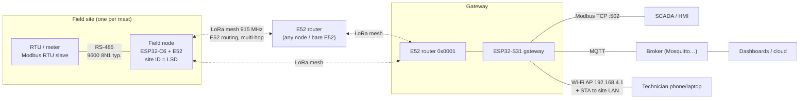
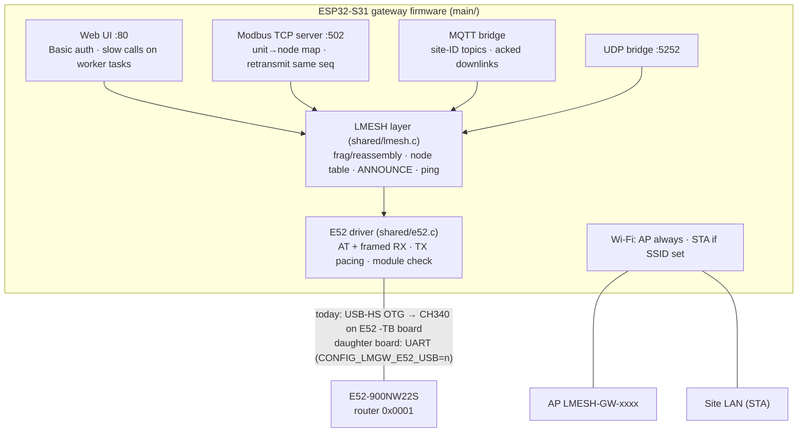

# LMESH design notes

LoRa mesh SCADA network: field RTUs on RS-485 → masthead nodes → Ebyte E52 LoRa mesh → border gateway → Modbus TCP and MQTT.

This document collects how the system is built and what bench bring-up taught us (November 2026). Code lives in this repo:
- `main/`: gateway firmware
- `node/`: field node firmware
- `shared/`: E52 driver and the LMESH layer, used by both
- `tools/`: bench tools

Drawings:
- [node-wiring.svg](node-wiring.svg): field node wiring as built and tested
- [e52-radio-schematic.svg](e52-radio-schematic.svg): minimum E52 radio circuit for the gateway and node daughter boards

---

## 1. System



The radios form the mesh on their own. LMESH is our thin layer on top: ports, fragmentation, request/response matching, retries and acknowledgements. It turns that mesh into something that behaves like UDP between the gateway and nodes.

## 2. Gateway



| Function | Detail |
|---|---|
| Modbus TCP :502 | Unit ID → node via the Unit Map (unmapped unit N goes to mesh node N). One transaction per node at a time. Retransmits the same seq after ~3× a normal round trip (1.2 s base at rate 1, about 2.4 s in total at rate 2). Gives up at `mb_timeout_ms` (6 s) with exception 0x0B. |
| MQTT bridge | Publishes node uplinks as `<base>/<site or NODE>/<sub>`. Subscribes `<base>/+/set/#` for downlinks. `gw/status` (LWT, retained), `gw/stats` and `gw/nodes` every 60 s. Starts in AP-only mode as well, for a broker on the AP side. |
| Downlinks | Each one is acknowledged by the node and resent up to 3× with the same seq (`gw_downlink()`). |
| Web UI | Status, Nodes (site column with ✎ editor, ping, discover), Modbus test, Radio/E52 apply plus AT console, Wi-Fi/MQTT, Unit Map. HTTP Basic auth, user `admin`; the password is `web_pass`, else the AP password. Ping, Modbus, AT and apply run on 2 worker tasks so the page stays responsive. |
| Wi-Fi | AP `LMESH-GW-xxxx` at 192.168.4.1 always. STA when `sta_ssid` is set (then the AP follows the STA channel). Power save off, 8 clients max. Bench: STA joined home LAN as 192.168.1.22. |
| Boot | Programs the E52 if the settings hash changed **or** the module's SRC_ADDR/CHANNEL/PANID/RATE differ from config (new or swapped module), then re-sends HEAD/BACK/CSMA. |
| Link column | The Nodes page shows each node's next hop and RSSI from the E52 route table (cached 10 s). |
| Mesh rate | Radio page: change the air rate of every node and the gateway together, with fallback (§4). |
| Firmware | Own update from the web page; stores node firmware and sends it over the mesh (§11). |

## 3. Field node

Hardware as built: see [node-wiring.svg](node-wiring.svg).

| XIAO ESP32-C6 | GPIO | to |
|---|---|---|
| D2 | 2 | RS-485 board TXD (UART0 TX) |
| D3 | 21 | RS-485 board RXD (UART0 RX) |
| D4 | 22 | E52 RXD (UART1 TX) |
| D5 | 23 | E52 TXD (UART1 RX) |
| D6 | 16 | E52 NRST (optional) |
| D1 | 1 | spare: DE if a non-auto-direction transceiver is used |
| D9 | 20 | OLED SDA (optional display; the first build needed SDA/SCL swapped, check with the bus scan in the boot log) |
| D10 | 18 | OLED SCL |

Firmware (`node/`):
- **Status display (optional).** 128×64 I2C OLED at 0x3C/0x3D, SH1106 by default (the 1.3" modules), SSD1306 selectable. Hot-pluggable. Shows site, mesh address and frequency, RSSI and next hop towards the gateway, RTU counters, last publish, and the poll values (six per page, 10 s per page). During a mesh firmware update line 5 shows the percentage.
- **Link report.** `rssi` and `hop` of the node's route to the gateway, plus `noack` and `resend` counters, in the status message and on the node's page.
- **Air-rate change on trial.** See §4, `radio` downlink.
- **Firmware update** over the node's Wi-Fi page or over the mesh, with trial boot and rollback. See §11.
- **Mesh Modbus pass-through.** `[unit][PDU]` on mesh port 502 → Modbus RTU master on RS-485 → reply with the same seq. A repeated seq gets the cached reply (it is not re-run on the bus). An RTU timeout or CRC error answers exception 0x0B immediately.
- **Poll and push.** A poll list (name, unit, FC1–4, address, type u16/s16/u32/s32/f32 plus word-swapped variants, scale, offset) is read every `poll_s`. The node publishes one JSON message per poll, `<base>/<site>/data` = `{"site":…,"t":uptime,"name":value,…}`. A failed read becomes `null` plus `_err`. Messages over ~560 bytes are split into self-contained chunks.
- **Downlinks.**
  - `write` maps `{"name","value"}` or a raw unit/addr through the point's scale (FC5/6/16) and answers on `write/ack`.
  - `poll` triggers an immediate poll.
  - `status` publishes the status message now.
  - `config` accepts only site/name/poll_s/poll and answers on `config/ack`.
  - Every downlink is acked; repeats are ignored.
- **ANNOUNCE.** Sent on boot, after the radio is programmed, whenever a `gateway` announces itself, and every 10 min. Payload `name\0rtu\0fw\0site\0`. Status is published every 10 min.
- **Local web page** on AP `LMESH-NODE-xxxx`:
  - live values
  - poll-list editor
  - RS-485 test
  - radio/AT console
  - site, RS-485 and Wi-Fi settings
  - external antenna select (XIAO GPIO3/GPIO14)
- **Default mesh address** comes from the MAC: 0x0100–0x7FFE (router range).

Verified with an R4AVA07 (7-channel 0–30 V input, unit 1, 9600 8N1): holding registers 0–6 = channels × 0.01 V; 7–13 = calibration ×1000.

## 4. LMESH protocol (on top of E52 unicast/broadcast)

Every E52 payload (max 200 B per the manual):

```
b0  0x10 | type   1=UDP 2=ANNOUNCE 3=PING 4=PONG
b1  seq           request/response matching; same seq on every fragment and every retry
b2  frag          (index<<4)|total, 0x01 = single; max 4 fragments (772 B)
b3..4 src port BE   b5..6 dst port BE   b7.. payload (≤193 B per fragment)
```

| Port | Direction | Payload | Reliability |
|---|---|---|---|
| 502 | gw ⇄ node | `[unit][Modbus PDU]` | gateway retransmits; node dedupes by seq and resends its cached reply |
| 1883 | node → gw | `subtopic\0payload` → MQTT `<base>/<site>/<subtopic>` | best effort (next poll replaces a lost one) |
| 1884 | gw → node | `subtopic\0payload` from MQTT `…/set/<subtopic>` | node acks with an empty UDP datagram (same seq); gateway resends ×3 |
| 5252 (gw) | LAN ⇄ node | UDP bridge to `10.52.<hi>.<lo>` | none |
| 69 | gw ⇄ node | firmware transfer, `shared/fwproto.h` | every packet acked with the next expected offset; CRC16 per packet, CRC32 over the image |

**Timing rule: wait after receiving before transmitting.** When a frame arrives, the two E52s are still exchanging their MAC ack. A reply written to the module inside that window is lost. The driver holds off 15 / 40 / 300 ms at rate 0 / 1 / 2 (`rx_holdoff_ms()` in `shared/e52.c`). Without it, rate 2 lost 37 % of pings.

**`radio` downlink: mesh-wide air-rate change with fallback** (`main/meshrate.c`, node `trial_step()`):
1. The gateway sends every node `{"rate":N,"in_s":S}`, with S chosen so all nodes switch at the same moment. Each must ack; if one does not, the others are cancelled and nothing changes (unless forced).
2. Everyone switches. The gateway pings the nodes at the new rate.
3. A node keeps the new rate, and saves it, only once it hears the gateway on it. After 180 s without the gateway it returns to the old rate.
4. If no node answers, the gateway returns too.
5. A node reset mid-trial boots on its configured rate, because `e52_matches_cfg()` now also compares RATE.

Known gap: a node that was off during a change stays on the old rate, out of reach, until the mesh is switched back (use the "leave behind" option to do that).

The ANNOUNCE payload is `name\0kind\0fw\0[site\0]`.
- The gateway announces itself as kind `gateway` (broadcast) on boot.
- Nodes answer with a unicast ANNOUNCE.
- The site ID is cleaned to be MQTT-safe: `/ + #`, spaces and control characters become `-`.
- If a second live node claims the same site, it is flagged as a duplicate and keeps its 4-hex number in topics. A holder silent for over 1 h gives the site up.

## 5. MQTT contract

| Topic | Payload |
|---|---|
| `<base>/gw/status` | `online` / `offline` (retained, LWT) |
| `<base>/gw/stats` | uptime, radio counters, MQTT up/down (60 s) |
| `<base>/gw/nodes` | node table with `site` (60 s, retained) |
| `<base>/<site>/data` | poll JSON |
| `<base>/<site>/status` | node fw, uptime, address, RTU and radio counters (10 min) |
| `<base>/<site>/set/write` → `write/ack` | write a point |
| `<base>/<site>/set/config` → `config/ack` | site/name/poll list |
| `<base>/<site>/set/poll`, `set/status` | on-demand poll or status |

`<base>` defaults to `lmesh/<last 4 hex of gateway MAC>`. `<site>` is the node's site ID (LSD), else its 4-hex mesh address.

## 6. E52-900NW22S facts

From Ebyte's E52-400/900NW22S User Manual v1.4 plus our bench work.

**Hardware** (manual p.4–7, 31):
- **Supply:**
  - VDD pin 28, 1.8–3.6 V; absolute max 3.6 V.
  - ≥3.3 V is needed for the full 22 dBm.
  - No internal LDO.
  - TX 128 mA peak, RX 14 mA.
  - Ebyte asks for a 22 µF low-ESR cap + TVS on the supply, and 1 µF + 100 nF at the pin.
- **Pins:**
  - GND: 13, 15, 27
  - TXD: 9 (module out)
  - RXD: 10 (module in)
  - NRST: 17 (10 k pull-up + 100 nF)
  - PA0/BOOT: 7 (low at power-up = bootloader). Ebyte's p.7 drawing says 11; the pin table says 7.
  - PB3 LED2 status: 1 (active low)
  - PB4 TX indicator: 2 (active low)
  - ANT: 14 (50 Ω)
  - SWDIO/SWCLK: 29/30
  - All others NC.
- **Antenna:** IPEX on the module, or the stamp pad. The -TB board feeds its SMA from the pad through a 0 Ω resistor; remove it to use the IPEX.
- **-TB dev board:**
  - CH340X USB-serial.
  - TXD/RXD jumpers link the CH340 to the module. **Remove both to wire an MCU.**
  - `R C D G V` header = SWD (reset, clock, data, **GND**, VCC).
  - `3V3/VIN` jumper = module supply.

**Protocol and AT behaviour:**
- **AT replies** have no newline required: `AT+X=OK`, `AT+X=<value>` (`AT+CHANNEL=0x41,65`), `…=CMD_ERR` / `CMD_VALUE_ERR`. The module **never** echoes a command verbatim. The firmware treats an exact echo as a TX→RX loopback wiring fault.
- **The first command after idle is sometimes lost**; the firmware retries once.
- **Settings without a `<save>` argument go to flash**, but `CSMA_RNG` is **not** kept across a reset (verified). Firmware re-sends HEAD/BACK/CSMA on boot, after apply, and after a console `AT+RESET`/`AT+DEFAULT`.
- **Factory defaults:**
  - 868.125 MHz (channel 18)
  - 62.5k
  - PAN 0x1234
  - security enabled
  - address = low 15 bits of the MAC
  - CSMA 127 ms
- **Channel and rates:**
  - Frequency = 850.125 + channel MHz (0–79). We use channel 65 = 915.125 MHz.
  - Rates: 0 = 62.5k, 1 = 21.875k, 2 = 7k. Sensitivity −111 / −116 / −121 dBm; Ebyte's reference ranges 1.6 / 2.0 / 2.5 km.
  - These look like LoRa BW 500 kHz at SF5/SF7/SF9: 62.5k and 21.875k match SF5/SF7 exactly. The Wio-E5 sniffer receives rate 1 as SF7/BW500 with the private sync word (NET=OFF).
- **RX frames** with `AT+HEAD=1`: `C1|C2|C3|C4, len, PAN(LE), src(LE), dst(LE), data`.
- **One frame at a time.** The module has a 5-entry send buffer. Sending too fast returns `OUT OF CACHE` and **the whole buffer is flushed**. Pacing frames by airtime alone lost the 2nd/3rd frame of back-to-back sends. The firmware now paces airtime + CSMA_RNG + ack time + 20 ms.
- **`AT+BACK=1` reports every send's result:** `SUCCESS` / `NO ROUTE` / `NO ACK`. It is now always on. The driver counts the reports (`back_ok`, `back_noack`, `back_noroute` in the status API) and strips them from AT replies.
- **The module retries by itself.** Receivers see duplicates (28 replies to 25 pings), and `NO ACK` mostly means the ack was missed, not the frame. Resending on `NO ACK` therefore collides with the peer's reply: it raised Modbus retries at rate 2 from 9/50 to 23/50. The resend code is in the driver but disabled (`RESEND_MAX 0`).
- **Between 1 and 16 packets in 6,000 arrive damaged** in a way the radio's checks do not catch (seen in a 1 MB transfer; probably a byte lost between an MCU and its module, which shortens the frame). Anything that must be exact needs its own checksum.
- **Routes:**
  - The first unicast to a new destination waits for route discovery: ~8 s at 21.875k, ~25 s at 7k.
  - Routes live in RAM; `AT+ROUTER_SAVE=1` keeps them across resets.
  - `AT+ROUTER_READ=?` lists destination, next hop, score and **RSSI**. The driver caches it (`e52_routes()`); the gateway's Nodes page shows it in the Link column and each node reports its own route to the gateway.
  - On a relayed route the RSSI seems to describe the far hop, not the first one (gateway showed −19 dBm for a node behind a −45 dBm relay). Trust it on direct links.
- **Timeouts:**
  - Default ACK and route timeouts are 2.5 / 5 / 15 s by rate; about 5 hops and ~50 devices are supported at defaults.
  - Broadcasts are de-duplicated for 15 / 30 / 60 s.
  - The RF auto-resets after 5 min with no traffic (`RESET_TIME`).
- **Security:**
  - Air payloads are encrypted, but **with a default key shared by every stock E52**. Set your own key (`AT+KEY=<0…0x7FFFFFFF>`, write-only) and a non-default PAN before field deployment.
  - The sniffer sees a readable Zigbee-like header (src/dst/seq) with an encrypted body.
- **Remote configuration** through destination port 14 with `++AT+…` exists. It is powerful and dangerous, and we don't use it.
- **CSMA:** Ebyte recommends keeping 127 ms. We use 40 ms for latency (see §7). Revisit on dense networks.

## 7. Measured performance (bench, 1 hop, rate 1 unless noted)

| Test | Result |
|---|---|
| Modbus TCP read via gateway, PC node sim | rate 2 (7k) med ~1158 ms · rate 1 ~375 ms · rate 0 ~290 ms |
| CSMA 127 → 40 ms (ping RTT median) | 371 → 224 ms |
| HTTP API, before TCP_NODELAY | bimodal +1.0–1.5 s (Nagle + lwIP RTO) → <10 ms after |
| Raw frame loss | ~5–10 % per frame, both directions |
| Modbus 4 regs with retransmit | 40/40, avg 256 ms, max 321 ms |
| Modbus 100 regs (2-fragment reply) | 20/20, avg 541 ms |
| XIAO node → R4AVA07, Modbus TCP end to end | 30/30, avg 361 ms, max 649 ms (incl. 9600-baud RS-485) |
| Ping gateway ↔ XIAO node | 230–262 ms |
| 2-fragment uplink after downlink ack | 0/4 before pacing fix → 8/10 after (rest = RF loss) |
| Acked downlinks | 10/10 |

Two XIAO nodes with RTUs, bench, 25–50 Modbus reads of 4 registers per node (2026-11-21):

| Air rate | Success | Median | Slowest | Notes |
|---|---|---|---|---|
| 0 (62.5k) | 50/50 | ~255 ms | 1.35 s | Only ~60 ms faster than rate 1: most of the time is fixed overhead. Not worth the 6 dB. |
| 1 (21.9k) | 100/100 | ~320 ms | 0.5 s | No retries. |
| 2 (7k), before fixes | 114/120 | ~700 ms | 5.5 s | 23 % of reads retried, 37 % of pings lost. |
| 2 (7k), after fixes | 50/50 | ~0.9–1.1 s | 2.2 s | No retries. Fixes: RX→TX hold-off 300 ms, retry interval ~2.4 s, no resend on NO ACK. |

Firmware transfers:

| Transfer | Result |
|---|---|
| Gateway update over the LAN | 1.2 MB in 4 s; trial boot; confirmed after 8 s |
| Node update over the mesh, 1 hop, rate 1 | 1,098,096 B in 46 min 32 s (~390 B/s), 135 packets repeated, 1 damaged packet caught |
| Second node, same image (route started via a relay, ended direct) | 46 min 12 s, 119 packets repeated, 16 damaged packets caught |
| Mesh-wide rate change, 2 nodes | ~40 s per change, 6 changes, all nodes confirmed each time |
| Rate-change fallback (node alone on a wrong rate) | back on the old rate after 180 s |

Capacity estimate (one shared channel, kept under ~20 % busy; not measured): about 40 nodes at a 30 s poll on rate 1, about 12 on rate 2; ten times that at 5-minute polls. Each relay hop costs the airtime again.

## 8. Bring-up lessons

1. **E52 -TB board on an MCU:** pull both TXD/RXD jumpers and wire to the module side. Wires on both pins of one jumper loop TX to RX, and the firmware reports "link is an echo".
2. **Common ground is mandatory.** The -TB board's `G` on the SWD header, battery −, or the USB shell all work.
3. **Don't power the E52 from a dev board's 3V3 pin.** It draws 128 mA peaks.
4. **RS-485 board TXD/RXD labels vary.** If there's no reply, swap the ESP TX/RX, then A/B. An exception 11 from the gateway means the node got no answer on the bus.
5. **ESP32-C6 USB-Serial-JTAG resets the chip when a monitor opens the port** with DTR/RTS asserted. Monitor with DTR=RTS=False.
6. **The gateway's DHCP leases live in RAM.** After a reboot, clients get fresh leases and Windows may not rejoin by itself (`netsh wlan connect name=…`).
7. **A broker on the laptop:** Mosquitto's stock config listens on localhost only. Add `listener 1883` (plus auth in the field) and a firewall rule scoped to the gateway's subnet.
8. **While the laptop is on the gateway AP, it has no internet.**
9. **Windows build:** idf.py refuses MSYS. The `idf.cmd` wrapper clears `MSYSTEM` and sets the IDF environment. The S31 needs `--preview`. Kconfig changes need `idf.py reconfigure`.
10. **A node that goes silent after being moved:** check power wiring first. On the second node it was an intermittent 5 V wire, then a cold ground joint. If the E52 still routes for others (visible in the gateway's route table) but the node does not answer pings, the C6 is the part that is down.
11. **The node's Wi-Fi name uses the MAC, not the mesh address** (`LMESH-NODE-A0B0` is mesh node 22B1).
12. **Unit Map, third field:** it is the RTU's address on the RS-485 bus. 0 means "same as the TCP unit", which is wrong whenever the two differ and shows up as exception 0x0B.
13. **A laptop that changes address breaks MQTT.** The gateway publishes to a fixed broker address; reserve the laptop's address in the router.
14. **Windows can run out of TCP ports** (thousands of sockets stuck closing) and then nothing connects, including to the gateway. A reboot clears it.
15. **OLED modules:** the 1.3" ones are SH1106, not SSD1306 (2-pixel shift and a stripe at the edge if driven as SSD1306, and they need different power settings). Missing pixel rows that stay put are a damaged panel.
16. **Don't unplug a node during a rate change.** It comes back on the old rate and is unreachable until the mesh returns to it.

## 9. Hardware choices

**ESP for the masthead node.**
- **C6 serial ports:** the C6 has **two** full UARTs, and both are in use (RS-485 and E52). Plus one low-power UART on fixed pins.
- **Your daughter board needs 4 ports:** 2× RS-485 + RS-232 + E52.

| Option | UARTs | Fit |
|---|---|---|
| ESP32-C6-WROOM-1**U** | 2 + LP | Current firmware as-is; one RS-485 port (a single bus is multi-drop anyway) |
| ESP32-S3-WROOM-1**U** | 3 + USB OTG | All three serial ports on UARTs; E52 on UART if one port is dropped, or on USB-OTG via CH340 as the gateway does today |
| ESP32-P4 + C6 companion | 5 | Plenty of ports, but Wi-Fi goes through the companion chip (ESP-Hosted); more complex |

The **"U" module variants** have a U.FL connector instead of a PCB antenna.
- **On your own board,** use the -1U module and a short U.FL→SMA bulkhead pigtail through the enclosure. It needs no 2.4 GHz RF layout, and the connector strain goes to the enclosure, not the PCB.
- **The same applies to the E52:** use its IPEX socket with a pigtail, or the stamp pad and an edge SMA as in [e52-radio-schematic.svg](e52-radio-schematic.svg).

## 10. Open items and roadmap

Done since the first version of this document: link RSSI and next hop on the gateway and nodes, `AT+BACK=1` counters, node display, mesh-wide rate change, reliable 7 kbps, firmware updates (§11).

Open:
- **Failure-path tests of the firmware update:** resume after an interruption, an actual rollback, and an update over a relayed (two-hop) route have not been exercised on hardware. Node upload over its own Wi-Fi page is untested.
- **7 kbps hold-off:** 300 ms is safe but may be more than needed; a node on 128 ms did as well in one 25-read run and was ~250 ms faster per read. Needs a longer run.
- **`radio` downlink from MQTT:** a node accepts a rate change published to `<base>/<site>/set/radio`. It heals itself after 180 s, but the command should be limited to the gateway's own page.
- **Node 22B1's direct link:** it usually reaches the gateway through 4498 even at bench distance. Check its antenna path.
- **OLED wiring:** confirm whether SDA is on D9 or D10 on the working build and fix the tables.
- **Mesh map and link-quality page:** the data now exists (routes, RSSI, ack counters); the page does not.
- **Faster mesh updates:** stop-and-wait gives ~390 B/s. Sending two or three packets per ack, or compressing the image (~40 % smaller), would cut the 47 minutes.
- **Send on change** for poll data, to stretch channel capacity.
- **Gateway display:** same OLED on the S31 once free pins are known.
- **Network key:** set your own `AT+KEY` and a non-default PAN, managed from the gateway and node config.
- **Wio-E5 RF instrument:** sniffer and carrier generator on stock firmware; a 902–928 MHz RSSI sweep would need custom firmware.
- **GPS survey unit:** firmware and gateway Survey tab are built (§12) but untested: needs a GPS wired to a node and a walk.
- **DHCP leases:** persisting them would need a patched IDF dhcpserver; not done.
- **Node with DE-pin transceivers:** use UART RS-485 half-duplex mode with RTS on D1.
- **Node board** on the -1U modules and the daughter-board radio section.

## 11. Firmware updates

Both projects use the same flash layout (`partitions.csv`): NVS at its original place, then two app slots of 1.875 MB (`ota_0`, `ota_1`). A board needs one USB flash with this layout; after that no cable.

| Path | How | Measured |
|---|---|---|
| Gateway, over LAN or its AP | Firmware card on the gateway page, `build/lmesh_gw.bin` | 1.2 MB in 4 s |
| Node, over its own AP | Firmware card on the node page, `node/build/lmesh_node.bin` | untested |
| Node, over the mesh | "Node firmware over the mesh" card on the gateway page | 1.07 MB in 46.5 min, 1 hop, rate 1 |

Common rules (`shared/ota.c`):
- The upload is checked before anything changes: ESP image magic, project name (a gateway file is refused by a node and the reverse), then the IDF image verification.
- The new firmware boots **on trial**. The gateway keeps it once someone logs in to its web page. A node keeps it once it can ping the gateway. No proof in 10 minutes restarts into the previous firmware (bootloader rollback). A node on a bench with no gateway can be confirmed by hand ("Keep it").

Over the mesh (`shared/fwproto.h`, `main/nodefw.c`, `node/main/fwup.c`):
- The node image is stored once in the **gateway's idle firmware slot**. A gateway update overwrites it, so store it again afterwards.
- One node at a time. Each 182-byte packet carries a CRC16; the node answers with the next offset it expects, which handles loss, duplicates and resume. The whole image is checked by CRC32, then by the IDF verification, before the node switches.
- An interrupted transfer resumes when started again, provided the node has not restarted in between.
- Needs node firmware 0.6.1 or newer on the receiving node.

The E52 modules run Ebyte's firmware and are not updated by any of this.

## 12. GPS survey unit (built, not yet tested on hardware)

Goal: carry a unit around, log position with signal strength, see how multi-hop routes behave, and compute path loss against distance from the gateway.

**The unit** is a XIAO C6, an E52 and a GPS module. No RTU and no RS-485 board. It runs the normal node firmware (0.7.0 or newer) with one setting changed.

**Module.** The boards marked NEO6MV2 carry a u-blox NEO-6M: 3.3–5 V supply, about 45 mA, NMEA sentences at 9600 baud once a second, 3.3 V logic. Expect a first fix to take from half a minute outdoors to several minutes; indoors it may never fix. (From memory of the common module; check the board in hand.) Any NMEA receiver at 9600 baud should work: the firmware reads only GGA and RMC and drops sentences with a bad checksum.

**Wiring.**

| GPS module | XIAO C6 |
|---|---|
| TX | D3 (GPIO21), the pin the RS-485 board's RXD used |
| VCC | 3V3 (or 5V if the module has its own regulator) |
| GND | GND |
| RX | not connected |

E52 and optional OLED as on any node.

**Set-up.**
1. On the node's own page: Settings → RS-485 card → "This port is used for" → **GPS survey unit**, set the report interval (10 s default), Save, reboot.
2. On the gateway page: Survey tab → enter the gateway's latitude and longitude and the combined antenna gain (4 dBi default for two small whips), Save.
3. Give the unit a site ID, for example `SURVEY-1`, so its MQTT topic is readable.

**What it sends.** Every `pos_s` seconds, `<base>/<site>/pos`, one radio frame:
`{"n":123,"fix":1,"lat":51.045120,"lon":-114.063010,"alt":1084,"hdop":1.1,"spd":3.2,"sats":9,"utc":"2026-11-22T17:03:10Z","rssi":-87,"hop":"0001","rtt":412}`
- `n` counts reports, so gaps show what was lost on the way.
- `rssi` and `hop` are the unit's route to the gateway at that moment; `hop` equal to the gateway's address means a direct link.
- `rtt` is a ping to the gateway taken for this report; −1 means no answer.
- Reports are sent without a fix too (`"fix":0`), so link quality is logged even indoors. `"gps":"silent"` means the receiver is not sending anything: check the wiring.

**What the gateway adds** (`main/survey.c`), published as `<base>/<site>/survey` and kept in RAM (last 600 points):
- its own RSSI and next hop for that unit,
- distance from the gateway's configured position,
- on direct links: `loss_db = TX power + antenna gain − rssi`, the free-space loss at that distance (`32.44 + 20·log10(MHz) + 20·log10(km)`), and the difference `excess_db`. That excess is what terrain and obstructions cost, the number worth mapping.

**Survey tab on the gateway page.** A track plot (north up, gateway at the centre, range rings, colour by signal, white outline for relayed points), a loss-against-distance chart with the free-space line, the latest points in a table, delivery percentage from the gaps in `n`, CSV download and Clear. It draws without internet. Points are lost when the gateway restarts; use the CSV or MQTT to keep them.

**The unit's display** shows GPS state and satellites, then latitude, longitude, altitude and speed in place of RTU values.

**Limits to know beforehand.**
- The E52 reports RSSI as whole dBm per route, updated only when traffic flows, and on relayed routes it seems to describe the far hop. Loss is therefore only computed for direct links; relayed points still record hop, RTT and delivery.
- A NEO-6M position is good to a few metres: fine for path loss at hundreds of metres, poor below about 50 m.
- The antenna gain setting shifts every loss figure by the same amount. Calibrate it once at a known short, clear distance if absolute numbers matter.
- Modbus requests to a survey unit get exception 0x0B, since it has no RTU.

**Other ways to connect a GPS, not built:** a software receiver on a spare pin (D0, D1, D7, D8) would let a node keep its RTU and have GPS; the C6's low-power UART is a third option but sits on the XIAO's underside pads.

**Not done yet:** GPS time on ordinary poll data (`t` is still uptime), storing survey points across a gateway restart, map tiles.
